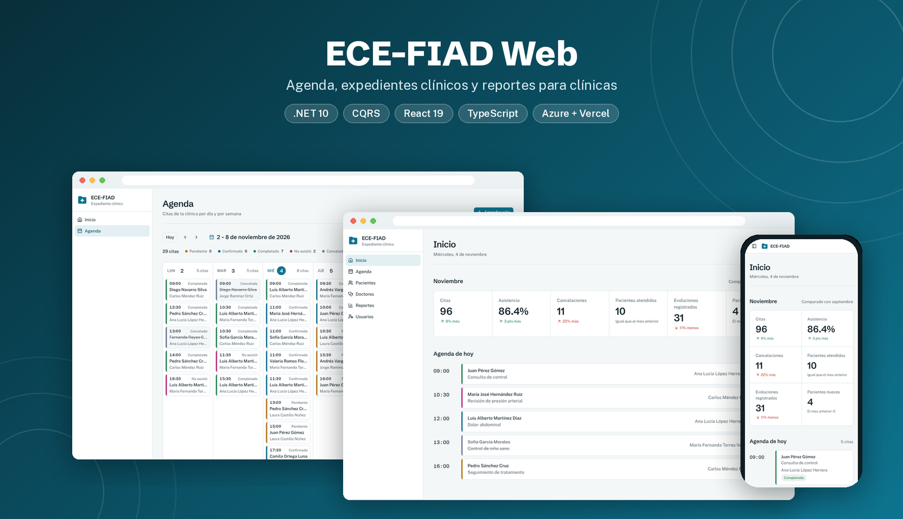
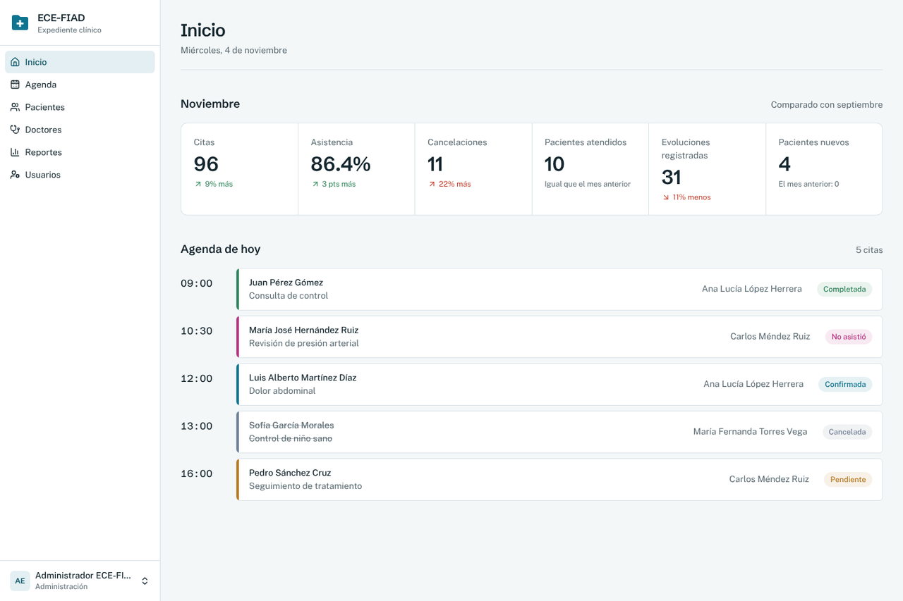
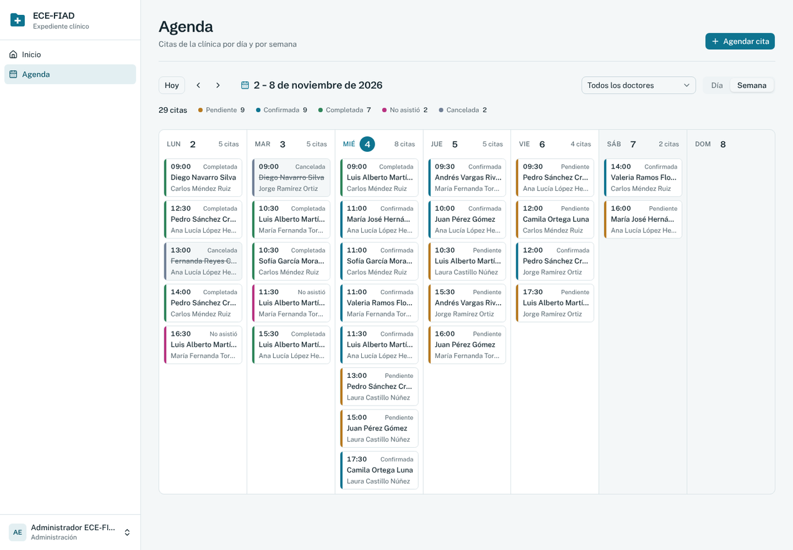
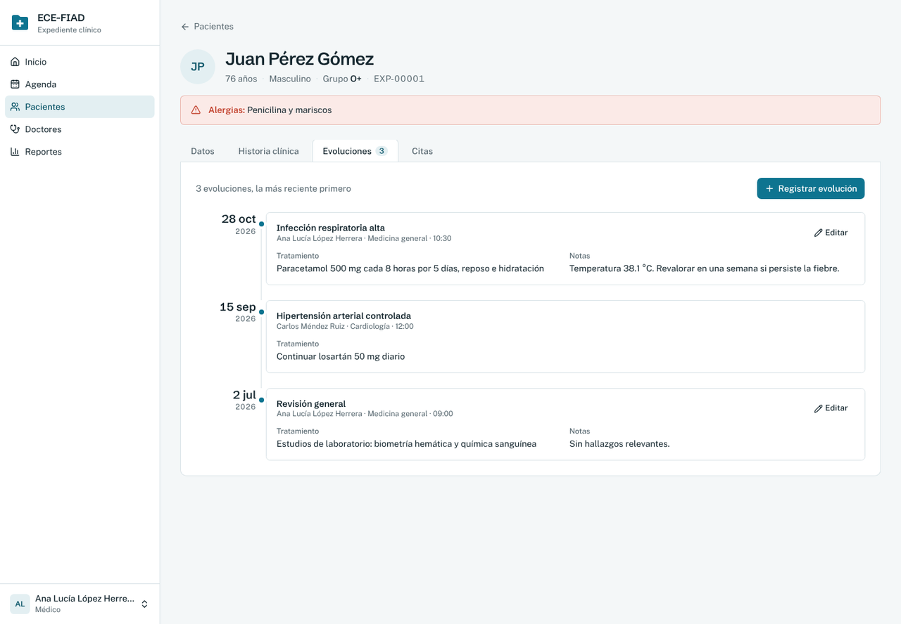
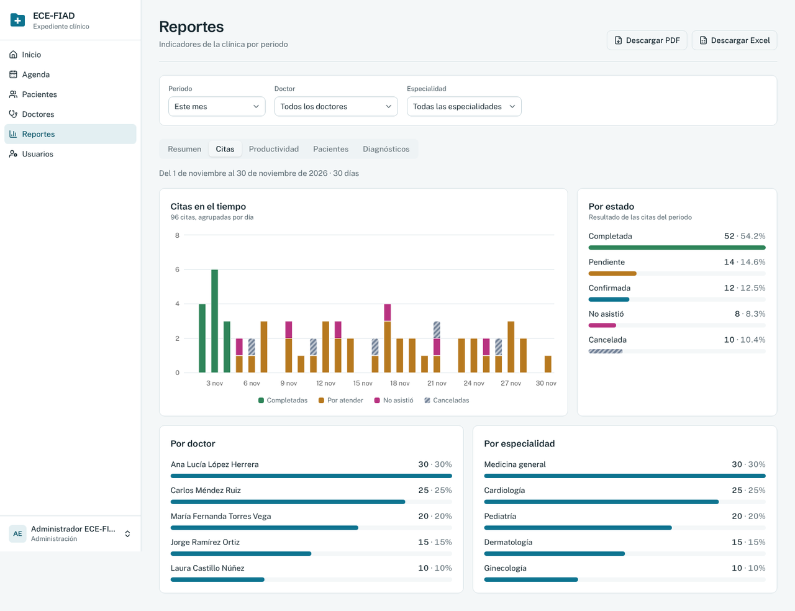
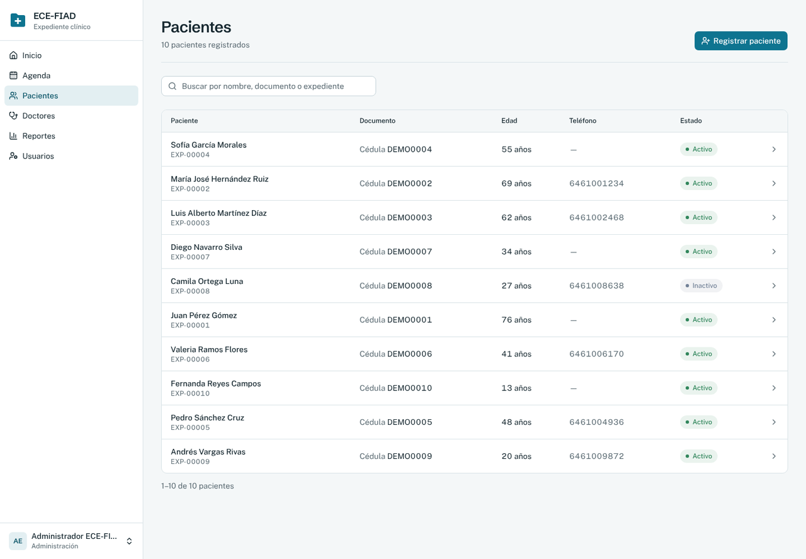
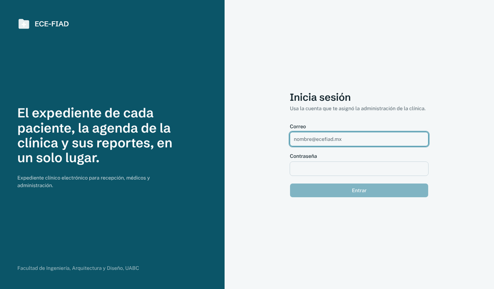
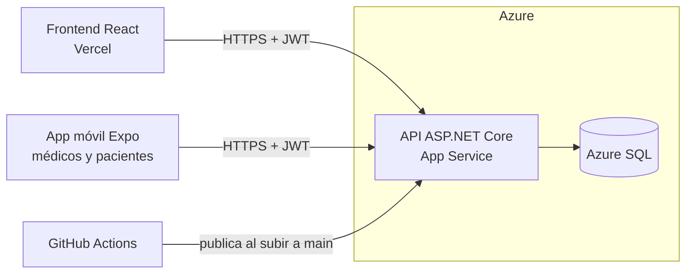

<p align="center">
  
</p>

<h1 align="center">ECE-FIAD Web</h1>

<p align="center">
  Expediente clínico electrónico para clínicas: agenda de citas, pacientes con historia clínica y evoluciones,<br>
  doctores, reportes con exportación a PDF y Excel, y cuentas por rol.
</p>

<p align="center">
  <a href="https://ece-fiad-web.vercel.app"></a>
  <a href="https://github.com/BrayanArM98/ece-fiad-movil"></a>
</p>

<p align="center">
  
  
  
  
  
  
  
  
</p>

---

## Contenido

- [Capturas](#capturas)
- [Funcionalidades](#funcionalidades)
- [Arquitectura](#arquitectura)
- [Tecnologías](#tecnologías)
- [Estructura del repositorio](#estructura-del-repositorio)
- [Ejecutar en local](#ejecutar-en-local)
- [Despliegue](#despliegue)
- [Especificaciones](#especificaciones)
- [Autor](#autor)

## Capturas

<table>
  <tr>
    <td width="50%"><p align="center"><b>Inicio</b> · indicadores del mes y agenda de hoy</p></td>
    <td width="50%"><p align="center"><b>Agenda</b> · vista de día y de semana por doctor</p></td>
  </tr>
  <tr>
    <td><p align="center"><b>Expediente</b> · alergias, historia clínica y evoluciones</p></td>
    <td><p align="center"><b>Reportes</b> · gráficas y descarga en PDF o Excel</p></td>
  </tr>
  <tr>
    <td><p align="center"><b>Pacientes</b> · búsqueda y número de expediente</p></td>
    <td><p align="center"><b>Inicio de sesión</b> · cuentas por rol con token JWT</p></td>
  </tr>
</table>

## Funcionalidades

**Administrador**
- Gestiona usuarios, doctores, especialidades y todo lo que hacen los demás roles.

**Recepción**
- Agenda de día y de semana: agenda, reprograma y cancela citas, sin empalmes de horario por doctor.
- Registro de pacientes con búsqueda que ignora acentos.
- Reporte de citas.

**Médico**
- Su agenda y el registro del resultado de cada cita (completada o no asistió).
- Expediente clínico: historia clínica, alergias resaltadas y evoluciones en línea de tiempo.
- Reportes de su productividad, pacientes y diagnósticos frecuentes.

**Paciente**
- Usa la [app móvil](https://github.com/BrayanArM98/ece-fiad-movil): consulta solo sus citas y recibe recordatorios.

**Reportes:** resumen con comparación contra el periodo anterior, citas por día y por estado, productividad por doctor, pacientes y diagnósticos, con filtros de periodo, doctor y especialidad, y exportación a PDF y Excel.

## Arquitectura



La API sigue una arquitectura en cuatro capas con CQRS:

- **Dominio:** entidades y enumeraciones.
- **Aplicacion:** comandos y consultas con MediatR, validaciones con FluentValidation, DTOs con AutoMapper y reglas de acceso por rol.
- **Infraestructura:** Entity Framework Core, repositorios, migraciones y exportación de reportes (QuestPDF y ClosedXML).
- **API:** controladores REST, autenticación JWT, límite de intentos de inicio de sesión y Swagger.

## Tecnologías

- **API:** .NET 10, ASP.NET Core, MediatR, FluentValidation, AutoMapper, Entity Framework Core, SQL Server, JWT, QuestPDF, ClosedXML.
- **Frontend:** React 19, TypeScript, Vite, Tailwind CSS 4, shadcn/ui, TanStack Query, React Router, Recharts, date-fns.
- **Despliegue:** Vercel (frontend), Azure App Service y Azure SQL (API y base de datos), GitHub Actions (publicación automática de la API).

## Estructura del repositorio

```text
ece-fiad-web/
├── backend/
│   ├── Dominio/            # Entidades y enumeraciones
│   ├── Aplicacion/         # Comandos, consultas, validaciones y DTOs (CQRS)
│   ├── Infraestructura/    # EF Core, repositorios, migraciones y reportes
│   └── API/                # Controladores, seguridad y configuración
├── frontend/
│   └── src/
│       ├── paginas/        # Una pantalla por módulo
│       ├── componentes/    # Componentes de cada módulo
│       ├── components/ui/  # Componentes base (shadcn/ui)
│       ├── lib/            # Cliente de la API, tipos y utilidades
│       └── sesion/         # Sesión y permisos por rol
├── specs/                  # Especificaciones (Spec-Driven Development)
└── .github/workflows/      # Publicación de la API en Azure
```

## Ejecutar en local

Requisitos: .NET 10 SDK, Node.js 22 o superior y SQL Server LocalDB.

1. Crea `backend/API/appsettings.Development.json` (no se sube al repositorio) con al menos:

   ```json
   {
     "Jwt": { "Clave": "una-clave-de-al-menos-32-caracteres" },
     "AdministradorInicial": {
       "Email": "admin@ecefiad.mx",
       "Contrasena": "Admin123",
       "NombreCompleto": "Administrador ECE-FIAD"
     },
     "BaseDeDatos": { "AplicarMigraciones": true },
     "DatosDemostracion": { "Habilitar": true, "Contrasena": "Demo1234" }
   }
   ```

2. Levanta la API:

   ```bash
   cd backend/API
   dotnet run --launch-profile http
   ```

   La primera vez crea la base, el administrador y los datos de demostración. La documentación queda en http://localhost:5200/swagger.

3. En otra terminal, levanta el frontend:

   ```bash
   cd frontend
   cp .env.example .env.local
   npm install
   npm run dev
   ```

   Abre http://localhost:5173.

Con los datos de demostración se crean `recepcion@`, `medico@` y `paciente@ecefiad.mx` con la contraseña de `DatosDemostracion:Contrasena`.

## Despliegue

- **Frontend:** Vercel publica `frontend/` en cada cambio a `main`.
- **API:** GitHub Actions compila y publica `backend/` en Azure App Service en cada cambio a `main` ([`api-azure.yml`](.github/workflows/api-azure.yml)).
- **Base de datos:** Azure SQL (oferta gratuita); la API aplica las migraciones al arrancar.

Los pasos completos están en [`specs/despliegue.md`](specs/despliegue.md). El plan gratuito de Azure duerme la API tras 20 minutos sin uso, así que la primera petición puede tardar alrededor de un minuto.

## Especificaciones

El proyecto se desarrolla con **Spec-Driven Development**: cada módulo tiene su especificación antes del código. Están en [`specs/`](specs/README.md): pantallas, diseño, reportes y despliegue.

## Autor

**Brayan Arturo Rocha Meneses**
Ingeniería en Software y Tecnologías Emergentes · Facultad de Ingeniería, Arquitectura y Diseño, UABC.
Proyecto de la materia Aplicaciones Web.

## Licencia

[MIT](LICENSE)
